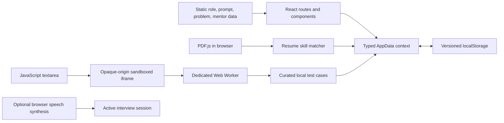

# Adroit

**Upskill. Practise. Perform. Connect.**

I built Adroit as a browser-based career preparation studio for students and early-career candidates. I brought resume-to-role comparison, coding practice, guided mock interviews, consultation preparation, and progress tracking into one responsive application. I designed it to work without an account, a custom backend, a database, a paid API, or an AI key.

Adroit is a practice tool. I do not present its keyword matches or self-review scores as measures of competence, hiring decisions, or guarantees of employability.

## What I built

- **Dashboard (`/`)**: I calculate resume match, solved-problem count, coding test accuracy, and completed-interview count from saved local records. I choose a suggested next step using simple, deterministic rules and show empty states when there is no activity.
- **Resume analysis (`/resume`)**: I parse text-based PDFs in the browser, let the user inspect/edit extracted text, and compare detected skills with one of seven local role profiles. I also support an optional job description, report export, and explicit local save/delete.
- **Coding library (`/coding`)**: I created 46 original practice problems across common data-structure and algorithm patterns. Users can search by title/topic, filter by difficulty/topic/completion/preparation track, sort the list, inspect hints and reference solutions, and run or submit JavaScript.
- **Coding workspace (`/coding/:questionId`)**: I use a focused textarea editor, starter code, example cases, progressive hints, a reference solution, a per-problem elapsed timer, and a local test runner. I save drafts in the browser.
- **Mock interviews (`/interviews`)**: I let users select a role, interview focus, difficulty, and question count. Sessions show one prompt at a time, save answer drafts, track elapsed time, and finish with a candidate-led review.
- **Kilo**: I added an opt-in, fixed-script coach to active mock interviews. Kilo can speak breathing/focus guidance and read the current prompt using browser speech synthesis. It does not listen, use a microphone, or generate AI responses.
- **Industry Connect (`/connect`)**: I provide six illustrative sample profiles with filters for stage, industry, expertise, and consultation topic. Users can choose topics and save career goals, questions, and an agenda locally.
- **Progress (`/progress`)**: I derive reports, attempts, interview history, and topic accuracy from actual records. Users can filter by time, delete individual records, and export JSON or CSV.
- **Settings (`/settings`)**: I store the preferred role, coding language, interview duration, and appearance. Users can export or clear local data and review privacy limitations.

## Routes

| Route | What I render |
| --- | --- |
| `/` | Local-data dashboard and next-step recommendation |
| `/resume` | PDF/text input, role comparison, report, saved analyses |
| `/coding` | Searchable, filterable, sortable problem library |
| `/coding/:questionId` | Problem statement, JavaScript editor, local test results |
| `/interviews` | Session setup and completed-session history |
| `/interviews/session/:sessionId` | Active prompt flow or completed self-review |
| `/connect` | Sample mentor directory and consultation preparation |
| `/progress` | Date-filtered local activity and exports |
| `/settings` | Preferences, privacy explanation, data export/deletion |

I use React Router with `BrowserRouter` for these routes. The static host must rewrite unknown application paths to `index.html` so that direct links and refreshes continue to work.

## Technology stack

| Technology | How I use it |
| --- | --- |
| React 19 | I build the shell and route-level screens as React function components with hooks. |
| TypeScript 5 | I define the persisted records, question models, and module contracts in `src/domain.ts`; strict checks run before production bundling. |
| Vite 6 | I use Vite for development, asset handling, testing configuration, and static production output. |
| Tailwind CSS 4 | I include the Tailwind Vite integration; most of the visual system is implemented with maintainable CSS and design tokens rather than utility-heavy markup. |
| React Router 7 | I define the client-side routes and use route parameters for individual problems and interview sessions. |
| Lucide React | I use Lucide icons for navigation, controls, status, and actions. |
| PDF.js | I dynamically load PDF.js when a user chooses a PDF and extract text in the browser. |
| Browser Web APIs | I use `localStorage`, `FileReader`, `Blob`, object URLs, Web Workers, sandboxed iframes, and optional `SpeechSynthesis`. |
| Vitest, Testing Library, jsdom | I test the matching algorithms, local persistence, route rendering, core workflows, question data, and Kilo's voice states. |

I do not use a custom API, database, authentication provider, analytics service, payment integration, remote code judge, or mandatory external service. I also do not currently use Monaco Editor, IndexedDB, a charting package, or a server-side runtime.

## How I organized the code

```text
.
├── index.html                 # Static HTML entry point
├── package.json               # Scripts and dependency declarations
├── vite.config.ts             # React, Tailwind, and Vitest configuration
├── tsconfig.json              # TypeScript project references
├── tsconfig.app.json          # Strict application type checking
├── public/
│   └── _redirects             # Netlify-style SPA fallback
├── src/
│   ├── main.tsx               # React root, BrowserRouter, CSS imports
│   ├── App.tsx                # App state, shell, routes, and route screens
│   ├── domain.ts              # Types and static role/question/mentor catalogs
│   ├── resume.ts              # PDF extraction, alias dictionary, matching
│   ├── runner.ts              # Sandboxed JavaScript execution and comparison
│   ├── storage.ts             # Versioned localStorage and JSON export
│   ├── styles.css             # Base styles and component layouts
│   ├── refresh.css            # Adroit visual refresh, themes, and motion
│   ├── core.test.tsx          # Unit and interaction tests
│   └── testSetup.ts           # Testing Library setup
├── docs/
│   └── ARCHITECTURE.md        # Concise architecture and data-lifecycle notes
└── README.md
```

I keep the route components together in `App.tsx` so the capstone remains easy to navigate. I use a small React context (`DataContext`) for shared application data and feedback; I did not add a separate state-management library. Reusable UI pieces such as `Shell`, `Title`, `Section`, `Metric`, and `Empty` keep page structure consistent.

### Component responsibilities

- **`App`**: I load the saved `AppData`, persist updates, apply the selected theme, provide the shared context, and declare the route table.
- **`Shell`**: I render the sidebar, mobile navigation, breadcrumb, page outlet, local-data indicator, and footer.
- **`Dashboard` / `Recent`**: I derive metrics from records and display the latest saved actions; I never seed fictional progress.
- **`Resume` / `SkillList`**: I handle role selection, file validation, text review, report display, consented save, export, and deletion.
- **`Coding` / `Workspace`**: I provide discovery controls and the per-question editor, draft persistence, timer, test results, hints, and reference solution.
- **`Interviews` / `InterviewSession` / `InterviewRow`**: I create and resume sessions, persist answers, navigate prompts, finish with confirmation, and support self-rating. Kilo's optional voice controls live in the active session.
- **`Connect`**: I filter the demonstration directory and edit topic selections and agenda notes for a chosen sample profile.
- **`Progress`**: I aggregate attempt results by topic and render date-filtered records and exports.
- **`SettingsPage`**: I update preferences and expose data counts, backup, deletion, and privacy details.
- **`NotFound`**: I provide a useful fallback for unsupported routes.

## Architecture and data flow

I ship this as a static single-page application. Static catalogs are imported from TypeScript. Route components update a single typed record; `storage.ts` serializes that record to browser storage. Resume files are handled as temporary input and are not stored. Coding attempts are based on actual test results. Interview ratings are self-reported.



### Local storage design

I store the versioned application record under `adroit.local.v1`. Its `AppData` fields are:

- `preferences`: role, coding language, interview duration, and theme.
- `analyses`: saved resume-to-role summaries.
- `attempts`: question ID, actual test pass count, timestamp, and duration.
- `interviews`: selected prompts, answer drafts, self-ratings, and completion time.
- `mentorNotes`: local goal, selected topics, questions, and agenda.

I keep coding drafts in separate `adroit.draft.<questionId>` keys and cap each draft at 50,000 characters. `loadData()` checks the version and expected top-level arrays, merges default preferences, and falls back to empty defaults for malformed or unsupported records. It does not implement historical schema migrations or deep validation of every nested field. `saveData()` catches storage failures; the UI warns if browser storage is unavailable or full.

## Resume extraction and matching

### PDF processing

I accept PDF files up to 5 MB. I read the chosen file with `FileReader` and load PDF.js dynamically, then extract text page-by-page with PDF.js's worker. Extracted text is shown in an editable field before analysis. If parsing fails or the PDF has no selectable text, I ask for pasted text or a text-based PDF. I do not implement OCR, upload the file, or persist the original PDF.

### Skill dictionary and boundaries

In `resume.ts`, I maintain a curated skill-to-alias dictionary (for example, `JS` maps to JavaScript, `NodeJS` maps to Node.js, and `K8s` maps to Kubernetes). I escape alias text before building case-insensitive regular expressions and require token boundaries. Short tokens use stricter boundaries so a standalone `C` does not match every occurrence of the letter in normal prose. Skill results are deduplicated and sorted. This is explainable keyword matching, not semantic NLP or section-aware resume understanding.

### Coverage formula

For a role profile, I assign weight 2 to every core skill and weight 1 to every secondary skill:

$$
	ext{coverage} = \operatorname{round}\left(
100 \times \frac{\sum_{s \in M} w(s)}{\sum_{s \in T} w(s)}
\right)
$$

Here, $T$ is the selected target-skill list, $M$ is the set of target skills found in resume text, and $w(s)$ is 2 for a core skill in the selected role and 1 otherwise. If the user supplies a non-empty job description, I extract its skills as $T$ and inspect the resume separately for evidence. A skill that appears only in the job description does not count as found in the resume. If the description contains no recognized skills, I show a zero score and an explicit explanation instead of silently falling back to the role profile.

My current profiles cover Frontend Developer, Backend Developer, Full-Stack Developer, Data Analyst, Data Scientist, Software Development Engineer, and DevOps Engineer. Each profile carries core/secondary skills, suggested topics, coding topics, and interview categories. Suggested topics come from simple deterministic matching and catalog fallbacks; I do not label them AI-generated.

I describe the percentage as resume-text overlap only. It does not establish a candidate's real ability or employability. When the user explicitly saves a report, I retain the detected/matched/missing skills, the selected basis, and at most a 400-character resume excerpt; I never save the original file.

## Coding library and runner

### Question catalog and discovery

I keep 46 typed questions in `domain.ts`. The catalog spans arrays, strings, hash maps, two pointers, sliding windows, sorting, binary search, recursion, linked-list representations, stacks/queues, trees, graphs, greedy strategies, and dynamic programming. Each question provides an ID, difficulty, topics, statement, input/output contract, constraints, three test cases, starter code, hints, a reference solution, complexity notes, and company-oriented preparation tags.

The company labels (Google, IBM, Amazon, Microsoft, and Meta) are preparation playlists derived from overlapping topic categories. They are not sourced or verified records that a specific company asked that exact question, and they do not imply company affiliation or endorsement. I use them only to help organize practice by target.

The library applies search and selected difficulty, topic, and completion filters to the local array. I support default catalog order, title order, and difficulty order. A problem counts as completed if at least one submitted attempt passes every provided case; merely opening it does not count. The workspace timer is an elapsed practice timer, not a timed multi-question assessment.

### JavaScript execution

The editor accepts one supported language: JavaScript. A submission must define `function solve(input)`. I pass each curated JSON input to that function and compare its result with the expected value. For comparison, I recursively sort object keys, preserve array order, and normalize JSON-compatible values; test errors are surfaced per case. The saved attempt records actual passed cases, total cases, timestamp, and measured run duration.

I do not execute user code in the application window. `runner.ts` creates a disposable iframe with `sandbox="allow-scripts"`, giving it an opaque origin. A restrictive Content Security Policy allows the bootstrap and a blob Worker, while `connect-src 'none'` blocks network connections from that execution context. The Worker runs the solution so a synchronous infinite loop does not block the app's main thread. The parent removes the iframe after completion or a 1.8-second timeout. I cap code size at 50,000 characters and bound serialized output depth, collection sizes, and string lengths.

This is a practical local exercise runner, not an audited security boundary. Browser behavior can vary, and it should not be used to handle sensitive code or guarantee security against hostile code. I do not compile Python, Java, or other languages, call a remote judge, or claim hidden-test coverage.

## Mock interviews and Kilo

I keep interview prompts, frameworks, and question criteria in `domain.ts`. Session setup records a target role, focus category, difficulty, requested count, and suggested duration. I select questions from the chosen focus first, then fill any remaining slots from the rest of the local bank. During a session, I display one question at a time, track elapsed time, and save answer text to the shared local record as it changes. Moving between prompts does not imply an answer was completed. Finishing early asks for confirmation.

For review, I show each answer beside its question's reflection criteria and let the candidate rate it from 1 to 4. I do not compute an AI score or claim to automatically judge clarity, intelligence, or technical ability; the rating is the user's self-assessment.

Kilo is an optional fixed-script coach in the active session. When the user selects **Enable Kilo voice**, I use the browser's `SpeechSynthesis` API to speak breathing/focus prompts and the current question. **Hear question** repeats the current prompt, **Mute Kilo** cancels playback, and the same guidance remains visible as text. Kilo has no speech recognition, microphone permission, listening loop, conversational model, or generated feedback. Voice support and installed voices vary by browser.

## Industry Connect

I provide six illustrative profiles in static TypeScript data. Every profile is labeled as a sample identity; I do not represent real credentials, verified availability, real contact details, or an endorsement. Filters use the profile's stage, industry, expertise, and suggested consultation topics. The preparation form saves a career goal, a user-selected subset of suggested topics, questions, and an agenda locally. Saving does not send a request or book a meeting. No external booking URL is configured.

## Progress, exports, and settings

I derive dashboard and progress values from stored records rather than decorative or fabricated metrics. Coding accuracy is total passed test cases divided by total attempted test cases in the selected date range; repeated attempts are counted repeatedly. Topic accuracy adds each attempt's case counts to each topic attached to that problem. A solved-problem count is the number of unique question IDs with a fully passing attempt.

The progress page supports all-time, 30-day, and 7-day views. I export the selected progress rows as CSV, escaping embedded quote characters, and export the full local app record as JSON. Settings also provides an all-data JSON export and a confirmed clear action that removes the versioned record and coding-draft keys. Browser storage is device/browser-specific and is not automatically encrypted.

## Visual system and accessibility

I built the responsive shell around a desktop sidebar and a compact mobile menu. I use CSS custom properties for the cobalt, midnight, citrus, coral, neutral, border, and shadow tokens. `styles.css` provides foundational/component styles; `refresh.css` adds the high-energy visual layer, dark/system appearance, and short entrance/hover transitions. I respect `prefers-reduced-motion`, keep keyboard focus visible, use semantic labels and buttons, and provide written guidance when voice output is unavailable.

The editor is a labeled textarea rather than Monaco. I chose it to keep this browser-only capstone lightweight and dependency-simple; syntax highlighting and editor-specific navigation are not implemented.

## Run locally

I use Node.js 20 or newer and npm. From the project root:

```sh
npm install
npm run dev
```

Vite prints the development URL (in this workspace, it is typically `http://localhost:5173`). Other scripts:

```sh
npm test       # Run the Vitest suite
npm run build  # Strict TypeScript check, then create dist/
npm run preview # Serve the built static output locally
```

I do not require an `.env` file or secrets.

## Tests and verification

I use Vitest with Testing Library and jsdom. The current suite checks skill aliases and short-token boundaries, role weighting, job-description matching, storage fallback/save/clear, the question catalog, every reference solution against its supplied cases, route rendering, resume save consent, coding filters/sorting, interview creation, mentor filtering, and Kilo's unsupported-browser/opt-in voice behavior.

The suite does not launch a real browser. In particular, the iframe/Worker runner is not end-to-end tested in Chromium or across browser security implementations. `npm run build` verifies strict TypeScript and the Vite production bundle. I recommend a browser-based smoke test before treating the runner as security-sensitive software.

## Build and deploy as a static site

Run `npm run build` and deploy the generated `dist/` directory. I include `public/_redirects` for Netlify-style SPA fallback. On another static host, I configure a rewrite from unknown app paths to `/index.html` while leaving real assets untouched. If I deploy below a domain subpath, I configure Vite's `base` option for that path. No custom server is part of the design.

## Privacy and limitations

- I parse resume PDFs in the browser and do not upload or retain the original file.
- I save a resume report only after the user chooses **Save locally**; that report includes a short text excerpt.
- I store code drafts, interview answers, preferences, reports, attempts, and consultation notes in browser `localStorage`. The browser may clear this data, storage can fill up, and it is not automatically encrypted.
- I bundle the app and PDF.js from the configured static host. I do not add analytics, payment, mandatory API calls, or account registration.
- Kilo speaks through browser speech output only after the user enables it. Browser/OS voice behavior may vary; Kilo does not capture microphone audio.
- I do not provide OCR, remote code judging, secure adversarial execution, Monaco, speech recognition, AI interviewing, real mentor booking, user accounts, or cross-device synchronization.

## Possible next steps

If I extend the capstone, I would first add real-browser tests for Worker execution and timeout behavior, stronger schema validation/migrations, and accessible visual regression checks. I would consider IndexedDB only if record sizes outgrow localStorage. Any new language runtime, speech-recognition feature, AI service, or mentor-booking link would need an explicit privacy and security review before I described it as functional.